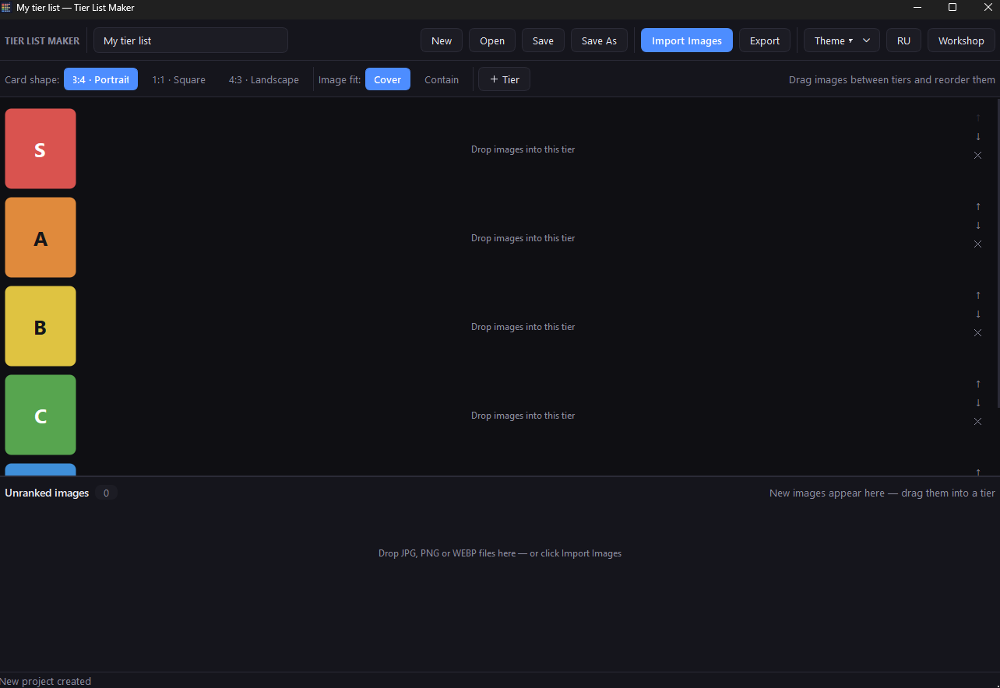

# Tier List Maker

Локальный редактор тирлистов для Windows 10/11. Проект и изображения хранятся на компьютере; для обычной работы интернет не нужен. Встроенная «Мастерская» умеет импортировать публичные шаблоны TierMaker.




## Возможности

- Импорт JPG/JPEG, PNG и WEBP: мультивыбор или перетаскивание из Проводника.
- Уровни рейтинга: добавление, удаление, переименование, цвет и изменение порядка.
- Перетаскивание изображений между уровнями и нераспределённой областью, изменение порядка карточек.
- Форматы карточек 3:4, 1:1, 4:3; режимы отображения «Заполнить» и «Вписать» без искажения пропорций.
- Отмена и повтор действий.
- Проект `.tierproj` — ZIP с `project.json` и оригиналами изображений в `images/`.
- Экспорт PNG/JPG с предпросмотром, заголовком, цветом фона, разрешением и настройкой нераспределённых карточек.
- Тёмная и светлая темы, переключение интерфейса RU/EN.
- «Мастерская»: категории, поиск, сортировка и избранное шаблонов TierMaker.
- Динамическая загрузка каталога: страницы шаблонов подгружаются по мере прокрутки, миниатюры — по мере появления на экране.
- Потоковый импорт: картинки шаблона добавляются в проект небольшими порциями сразу после скачивания. Шаблоны с тысячами изображений (больше 150) поддерживаются.

## Быстрый старт

Скачайте `TierListMaker.exe` из раздела **Releases** (если сборка опубликована) и запустите. Установка не требуется.

Если готовой сборки нет, соберите её самостоятельно — см. раздел «Сборка EXE».

## Запуск из исходников

Нужен Python 3.10 или новее.

```powershell
git clone <URL-репозитория>
cd TierListMaker

python -m venv .venv
.\.venv\Scripts\Activate.ps1

python -m pip install -r requirements.txt
python main.py
```

## Сборка EXE

Скрипты сборки используют PyInstaller и создают один самодостаточный файл `dist\TierListMaker.exe`.

PowerShell:

```powershell
powershell -ExecutionPolicy Bypass -File .\build_exe.ps1
```

Или двойным щелчком по `build_exe.cmd` из Проводника.

Готовая сборка запускается дольше обычного, поскольку Qt распаковывается при старте.

## Мастерская TierMaker

Мастерская использует только публичные страницы каталога и публичный endpoint изображений шаблонов:

- вход в аккаунт не требуется;
- CAPTCHA и ограничения доступа не обходятся;
- для работы мастерской нужен интернет.

Особенности загрузки:

- список шаблонов подгружается постранично по мере прокрутки;
- миниатюры загружаются лениво, только для видимых элементов;
- изображения шаблона скачиваются параллельно и сразу попадают в проект пачками;
- действуют защитные ограничения: до 5000 изображений и 3 ГБ на один шаблон.

## Горячие клавиши

| Действие | Клавиши |
|---|---|
| Новый проект | `Ctrl+N` |
| Открыть проект | `Ctrl+O` |
| Сохранить | `Ctrl+S` |
| Сохранить как | `Ctrl+Shift+S` |
| Импорт изображений | `Ctrl+I` |
| Экспорт | `Ctrl+E` |
| Отменить / повторить | `Ctrl+Z` / `Ctrl+Y` |

## Формат проекта

`.tierproj` — обычный ZIP-архив:

```text
project.json      метаданные: уровни, порядок карточек, настройки вида
images/<id>.png   оригиналы изображений без пережатия
```

## Структура репозитория

```text
main.py                 запуск приложения
tierlist/               исходный код: интерфейс, модель, импорт, экспорт
  workshop.py           каталог и парсер публичных шаблонов TierMaker
  main_window.py        главное окно
  model.py              модель проекта
  imagestore.py         хранение изображений
  export_dialog.py      диалог экспорта
  i18n.py               строки интерфейса RU/EN
assets/                 иконки приложения
docs/                   скриншоты
build_exe.ps1           сборка EXE (PowerShell)
build_exe.cmd           сборка EXE (CMD, двойной щелчок)
requirements.txt        зависимости приложения
requirements-dev.txt    зависимости сборки (PyInstaller)
```

## Лицензия

[MIT](LICENSE)